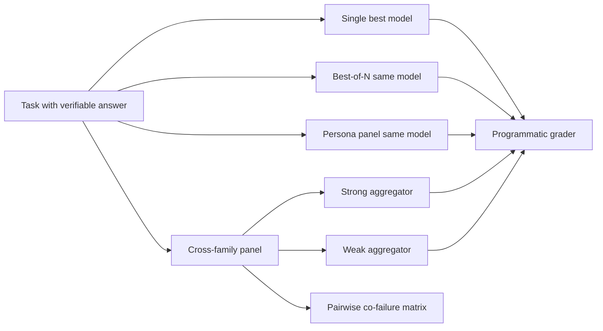

# Ensemble Reboot — Does Model-Family Diversity Actually Help?

## What we're building
A single consolidated experiment that supersedes the April 2026 ensemble trilogy (thinking-models, moa-bedrock-guide, persona-orchestrator). It measures whether combining models from *different labs* beats a single frontier model, best-of-N, or same-model persona panels at matched cost. It also treats reasoning effort (low → max) as an experimental axis, and directly measures pairwise co-failure between model families.

## Why (blog angle)
April's MoA result was "ensembles only win when proposers are weaker than the aggregator; equal-capability ensembles lose." That ran without the condition Wang et al. relied on, which is cross-lab diversity. Bedrock now serves OpenAI, xAI, Moonshot and Anthropic frontier models side by side. This is the first clean test of whether family diversity breaks the [[composition-ceiling]] (correlated failures) or confirms it.

## Roster (verified live 2026-10-22 via Bedrock ListFoundationModels + Converse smoke test, 10/10 OK)
Use `global.` inference profiles. **No pre-2026-H2 models in the panel.** April's roster (Opus 4.6, Sonnet 4.6, Haiku 4.5, Nova 1, Mistral 7B, Llama 3.1) is retired.

| Role | Model (profile id) | Released | Effort control (additionalModelRequestFields) |
|------|--------------------|----------|-----------------------------------------------|
| Frontier, Anthropic | global.anthropic.claude-fable-5-1 | 2026-08-31 | `output_config.effort`: low…max (default high) |
| Frontier, Anthropic | global.anthropic.claude-opus-5-5 | 2026-09-22 | `output_config.effort`: low…max (default medium) |
| Frontier, OpenAI | global.openai.gpt-6-astra | 2026-09-08 | `reasoning_config`: low…max (default medium) |
| Frontier, OpenAI | global.openai.gpt-6.1-sol | 2026-10-15 | `reasoning_config`: low…max (default medium) |
| Frontier, xAI | global.xai.grok-4.7 | 2026-09-28 | `reasoning_config`: low…xhigh (default high, no max) |
| Frontier, Moonshot | global.moonshotai.kimi-k3 | 2026-08-27 | `reasoning_config`: none…max (default max) |
| Mid, Anthropic | global.anthropic.claude-sonnet-5-5 | 2026-09-28 | `output_config.effort` |
| Cheap, Anthropic | global.anthropic.claude-haiku-5-5 | 2026-10-07 | `output_config.effort` |
| Cheap, OpenAI | global.openai.gpt-6-luna | 2026-09-22 | `reasoning_config` (has none) |
| Cheap, Amazon | global.amazon.nova-2-lite-v1:0 | 2025-12-02 | `reasoningConfig` (`maxTokens` must be unset at `high`) |

Not in the panel: Nova Pro/Premier v1 (2024-era; no Nova 2 Pro on Bedrock), DeepSeek V3.2, Mistral Large 3, Qwen3, MiniMax M2.5. These can be optional open-weight diversity arms if budget allows.
OpenClaw's configured `mantle/xai.grok-4.3` and `mantle/openai.gpt-5.5` are **superseded**. Grok 4.3 is no longer on Bedrock, and GPT-5.5 is two generations behind. Call Bedrock runtime directly.

## Architecture


## Scope
In:
- 5 arms: single-best, best-of-N, persona panel, cross-family + strong aggregator, cross-family + weak aggregator. All arms are cost-matched to within ±15%.
- Effort sweep: low / medium / high / xhigh (+ max where supported) on the single-best arm and on each panel member, plus at least one "low-effort cross-family panel vs high-effort single model" comparison.
- Task sets with headroom and programmatic grading only: GPQA-Diamond, hard competition math (AIME-style, exact-match), a code set with unit tests. Pick sets where the best single model is <80%.
- Co-failure: for every model pair, P(both wrong) vs P(A wrong)·P(B wrong).
- Judge/aggregator, if used for selection, must come from a family not on the panel (avoid self-preference).

Out:
- Open-ended LLM-judge scoring (April's main weakness).
- GSM8K / MT-Bench / AlpacaEval (saturated or judge-scored).
- Mock mode results in any reported number.

## Acceptance criteria
```gherkin
Given the 10-model roster above
When every arm runs on all three task sets with ≥3 seeds
Then each arm reports accuracy with 95% CI, cost per correct answer, and p50/p95 latency

Given panel members' per-item correctness
When the co-failure matrix is computed
Then each pair reports observed vs independent-expected joint failure rate

Given the effort sweep
When results are plotted
Then accuracy-vs-cost curves exist per model and per arm, and we can say whether effort or diversity buys more accuracy per dollar

Given any reported number
Then it traces to a raw JSONL record with model id, effort level, tokens, cost and grader output
```

## Key decisions
- Retire thinking-models (GSM8K saturated; Opus 4.6 obsolete). Carry over its one lesson: the judge must be ≥ the candidates.
- Persona orchestrator survives only as arm A3 (prompt diversity control).
- Spend gate: estimate the full-run cost from a 10-item pilot before running. CC approves any run >$100.
- Nova 2 Lite at `high` effort: omit `inferenceConfig.maxTokens` (Bedrock 400 otherwise).

## Resources
- April write-ups: `../ensemble-moa-bedrock-guide/BLOG.md`, `../ensemble-thinking-models/EXECUTIVE_SUMMARY.md` (stale −3% lines; see CRITICAL_FINDING_SELFCONS.md), `../ensemble-persona-orchestrator/BLOG.md` (mock-only)
- Smoke test: `scripts/smoke_roster.py`, `results/smoke_2026-10-22.json`
- Wiki: [[composition-ceiling]], [[correctness-vs-completeness-verification]], projects/llm-ensemble
