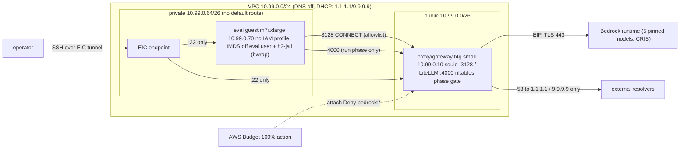

# harness2-eval infra

**TL;DR** — A disposable, two-instance AWS sandbox for running untrusted
Harness2/OpenCode eval rollouts against Bedrock models without letting
the rollout see credentials, the internet, or the oracle. One CDK app
(4 stacks), one squid+LiteLLM gateway box that is the guest's only way
out, phase-gated egress (closed / setup / run), a $3,500 default
model-spend cap enforced twice, and scripts that bring it up, arm a run
window, roll the guest back to a clean snapshot, and tear it all down.

**Status: never deployed.** Everything was built and verified
credential-free on an offline build host; see
[VERIFICATION.md](VERIFICATION.md) for exactly what that does and does
not prove, and section "Verified vs. unverified" below.

## Why

Harness2 rollouts execute model-written code. That code must be able to
call the five eval models (through a metered gateway) and nothing else:
no IMDS, no DNS tunnel, no package registries at run time (contamination
risk for the eval), no reading the judge's task.json, and no way to
spend unbounded money. Standard "private subnet + NAT" setups fail at
least three of those. This infra is the NetOps-reviewed answer.

## What it is

| Piece | What |
|---|---|
| `H2Network` | VPC 10.99.0.0/24, public /26 (proxy) + isolated /26 (guest), **VPC DNS disabled** + DHCP 1.1.1.1/9.9.9.9, locked SG matrix, EIC endpoint, KMS-encrypted VPC flow logs (ALL) |
| `H2Proxy` | t4g.small @ 10.99.0.10 + EIP: squid :3128 (allowlist CONNECT proxy), LiteLLM :4000 (Bedrock gateway, virtual keys, cost caps), nftables phase gate, IMDSv2 hop 1 |
| `H2Eval` | m7i.xlarge @ 10.99.0.70, 80 GB encrypted gp3, **no instance profile, IMDS disabled post-boot**, egress = proxy:3128 + proxy:4000 only |
| `H2Guardrails` | AWS Budget (ACTUAL 50/80/100% + FORECASTED 100%) + Budget Action that auto-attaches a `Deny bedrock:*` policy to the gateway credential at 100% |
| `scripts/` | setup.sh / run-arm.sh / restore-snapshot.sh / teardown.sh (operator); proxy bootstrap + h2-egress phase tool; guest bootstrap + h2-jail + smoke tests |



## Why it matters

The eval's integrity rests on the guest being unable to (a) exfiltrate
or look up answers, (b) read the oracle, (c) spend without a meter.
Every control here is doubled: SG matrix **and** squid allowlist; VPC
DNS off **and** squid denies IP-literal CONNECTs; LiteLLM `max_budget`
**and** the AWS Budget kill switch; no instance profile **and** IMDS
disabled; `eval` user **and** bwrap jail.

## Prerequisites

* An **isolated sandbox AWS account** (never a production account),
  CDK-bootstrapped (`cdk bootstrap`) in your region.
* Operator workstation: awscli v2, Node 20+/npm, Python 3.11+, an SSH
  keypair (public key goes into context as `operatorSshPublicKey`).
* Bedrock model access granted in the console for the five models.

## Install

The ONLY supported way to get this code:

```
git clone https://github.com/ccrngd1/ProtoGensis.git
cd ProtoGensis/harness2-eval/infra
```

There is no pip/npm package of this infra; anything claiming to be one
is not ours.

## Commands

```
make venv      # one-time toolchain
make verify    # lint + synth (cdk-nag enforced) + 120 pytest tests — all credential-free
make synth     # both credential modes, fixture context
make test      # pytest only
make lint      # shellcheck + account-literal scan (+ self-test)

# Deploy (operator workstation, real credentials, sandbox account):
scripts/setup.sh --dry-run          # prints the full plan, ZERO AWS calls
scripts/setup.sh                    # typed account confirmation required
scripts/run-arm.sh --run-id 1       # snapshot -> capped key -> phase run -> disarm trap
scripts/restore-snapshot.sh --snapshot baseline-clean
scripts/teardown.sh --dry-run       # read-only preview
scripts/teardown.sh
```

Account/region resolution (everywhere): explicit `--account`/`-c
account=` wins; otherwise ambient credentials (`sts get-caller-identity`
/ `CDK_DEFAULT_ACCOUNT`); region explicit → `AWS_REGION` → us-east-1.
**Explicit + ambient mismatch aborts before any cdk call.** No account
ID appears anywhere in this repo outside `tests/fixtures/`.

## Budget

Budget: Minimum tier, $3,500 default model-spend cap (CC decision
2026-10-22), overridable (`-c budgetCapUsd=` / `setup.sh --budget`).
The default lives in `cdk.json` context ONLY; `setup.sh` reads it from
there, so there is no second copy. Enforcement is two-layer:
**LiteLLM `max_budget` is primary** (per-key and gateway-wide, enforced
per request); the **AWS Budget + Action is the backstop** (AWS evaluates
budgets only a few times a day — do not rely on it for fast cutoff).
The Budget is account-wide spend by default (no Service=Bedrock-only
filter, which would miss cross-region inference line items); set
`-c budgetCostTagFilter=true` to scope it to `user:project$harness2-eval`
(requires activating that cost-allocation tag first).

## Cost table — ESTIMATES (us-east-1, 2026-10-22 public pricing; verify in Cost Explorer before trusting)

| Item | Rate (est.) | 2-week soak (est.) |
|---|---|---|
| m7i.xlarge guest | ~$0.202/h | ~$68 |
| t4g.small proxy | ~$0.017/h | ~$6 |
| Public IPv4 (EIP) | $0.005/h | ~$2 |
| EBS gp3 100 GB total | $0.08/GB-mo | ~$4 |
| Snapshots (~3 × ≤80 GB, incremental) | $0.05/GB-mo | ~$5–12 |
| VPC flow logs → CW (ingest+store) | ~$0.55/GB | ~$1–5 |
| KMS key | $1/mo | ~$0.50 |
| EIC endpoint, Budgets, SSM params | $0 | $0 |
| **Infra total** | | **~$90–100** |
| Model spend | metered by LiteLLM | capped at budgetCapUsd ($3,500 default) |

## Security decisions (for NetOps review)

1. **DNS option (a)**: VPC resolver disabled VPC-wide
   (`enableDnsSupport=false`) because the base+2/169.254.169.253
   resolver bypasses SGs — a ready-made exfil tunnel. DHCP hands out
   1.1.1.1/9.9.9.9; only the proxy SG can reach them (:53, two /32s).
   The guest can resolve nothing; names it CONNECTs to are resolved by
   squid on the proxy.
2. **No Docker on the guest** (NetOps C6): isolation vantages are
   `ubuntu`, `eval`, and `eval`-inside-`h2-jail` (bubblewrap). The
   AppArmor unprivileged-userns restriction stays ON; bwrap uses the
   distro profile. `unshare -Ur` as `eval` must fail (smoke-tested).
3. **Phase gate on :4000** (C8): LiteLLM reachability is nftables-gated
   on the proxy (`h2-egress {closed|setup|run}`); boot state is closed
   via a systemd unit ordered Before squid/litellm.
4. **Frozen allowlists** (§5.1): setup = 9 CONNECT hosts + 2 apt hosts;
   run and closed are EMPTY. Byte-frozen by tests; editing them fails
   the build until re-review.
5. **IAM inventory is exact** (R1/R9): gateway role+instance profile
   (proxy only), deny policy, Budget-Action exec role (scoped to the one
   policy ARN via `iam:PolicyARN`), flow-log role. No Lambda, no custom
   resources — enforced by tests that enumerate the templates.
6. **CRIS policy shapes** (§6.4): in-region FMs pinned by
   `aws:RequestedRegion`; us./global. profiles get profile-ARN allows
   plus per-destination FM ARNs conditioned on
   `bedrock:InferenceProfileArn`; global adds the region-less FM ARN
   with `RequestedRegion=unspecified`. No blanket RequestedRegion on
   CRIS statements. Invoke-only actions.
7. **R8/K1 SourceIp pin**: `Deny bedrock:* unless aws:SourceIp == proxy
   EIP/32` — default-on in role mode (context-disableable), forced in
   key mode.
8. **Keys never touch disk**: LiteLLM virtual key in guest tmpfs
   `/run/h2/keys.env` (0600 eval); key-mode AWS key in proxy tmpfs
   `/run/h2gw/aws.env` (0600 root). run-arm.sh deletes the gateway-side
   key (`/key/delete`) and shreds the guest copy in an EXIT/ERR trap.
   No secret appears in code, user-data, CFN parameters, or outputs
   (test-enforced).
9. **Proxy IMDS**: IMDSv2 hop 1 + nftables owner-match so only root and
   the `litellm` uid can reach 169.254.169.254; the guest's IMDS is
   disabled entirely post-bootstrap.

## Deviations (NetOps v2 §12 ack required)

* **`restrictDefaultSecurityGroup=false`**: CDK's implementation is a
  Lambda-backed custom resource, which R9 forbids. `setup.sh` revokes
  the default SG's ingress+egress rules right after deploy instead
  (step `default-sg`).
* **Flow-log group has a fixed name** (`/harness2-eval/flow-logs`) so
  `teardown.sh` can delete stragglers after a partial destroy.
* **`DISABLE_ADMIN_UI`**: this env var could NOT be confirmed in LiteLLM
  1.106.2 source. It is still set in the systemd unit, but the verified
  UI lockdown is `general_settings.ui_access_mode: admin_only` plus the
  virtual key's `allowed_routes: ["llm_api_routes"]`.
* **harness2 installed with `.[render]`, never `[bridge]`** per PreCog
  §3.2; `AWS_BEARER_TOKEN_BEDROCK` is explicitly unset for the demo.

## Runbook

1. **Bring-up**: `scripts/setup.sh` (resumable; state in
   `.h2-setup-state`). Order: deploy → wait → cloud-init.disabled →
   guest IMDS off → default-SG revoke → proxy bootstrap (squid,
   nftables, Postgres, LiteLLM w/ hash-pinned lock) → [key mode: place
   hand-made access key in proxy tmpfs] → **smoke-isolation (closed) —
   ABORTS setup on failure** → phase setup → guest bootstrap (pinned
   Node/Bun/Codex/OpenCode/harness2/harvey-labs) → smoke-isolation
   (setup) → phase closed → harness2-demo + **squid log must show zero
   allowed CONNECTs** → snapshot `baseline-clean`.
2. **Arm a run**: `scripts/run-arm.sh --run-id N [--max-budget 100]
   [--eval-cmd '...']`. Snapshot `pre-run-N` happens BEFORE the key
   exists. Disarm (even on crash/Ctrl-C): phase closed → shred guest
   keys.env → gateway `/key/delete` → export results/squid/spend logs
   to `runs/run-N/`.
3. **Between runs**: `scripts/restore-snapshot.sh --snapshot pre-run-N`
   (root-volume replacement, old volume auto-deleted), then re-run
   smoke-isolation before arming again.
4. **Spend check**: LiteLLM `/key/info` per key; `/spend/logs` export;
   AWS Budgets console for the backstop.
5. **Teardown**: `scripts/teardown.sh` — detach deny policy → K4 key
   check (key mode: aborts if any access key remains on
   `harness2-eval-bedrock`) → `cdk destroy --all` → delete tagged
   snapshots/volumes/log group → tag-scan verification → manual
   checklist (EIP, IAM user, CloudWatch, local logs).

## Verified vs. unverified

Verified on this build host (no AWS): synth both modes, cdk-nag zero
unsuppressed (7 justified acks), 120/120 pytest, shellcheck clean on all
16 scripts, account-literal scan clean + self-test, operator-script
dry-runs under poisoned stubs (setup.sh dry-run provably makes zero
AWS/ssh calls), allowlists byte-frozen, supply-chain pins checked
against live upstream checksums.

NOT verified (first deploy will test): CloudFormation acceptance, real
network isolation (that's what smoke-isolation.sh is for — setup aborts
if it fails), squid/nftables/LiteLLM behavior, Bedrock policy shapes
against the live control plane, Budget Action end-to-end, guest
bootstrap, and all costs. Full list with order-of-attack in
[VERIFICATION.md](VERIFICATION.md).

## Layout

```
infra/
├── app.py, stacks/            CDK app (4 stacks, config, CRIS policy builder, nag acks)
├── scripts/                   setup / run-arm / restore-snapshot / teardown + lib/
│   ├── proxy/                 squid.conf, allowlists (frozen), h2-egress, LiteLLM cfg+lock, bootstrap
│   └── guest/                 guest-bootstrap, h2-jail, smoke-isolation/-harness2/-paid
├── tests/                     120 tests; fixtures/ holds the ONLY account literal
├── dev/                       no-aws-env.sh, synth-local.sh, check-no-account-ids.sh, lock regen
├── Makefile                   venv / synth / nag / test / lint / dry-run / verify
├── VERIFICATION.md            what is and is not proven
└── NETOPS-CHECKLIST.md        §12 items + R/K checks → file:line + test
```
